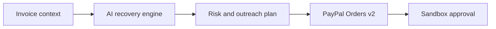

# PayPilot AI

**Get paid without burning bridges.** PayPilot is an AI accounts-receivable copilot for freelancers and small businesses. It reads the context around an overdue invoice, recommends a humane recovery strategy, drafts personalized outreach, proposes a payment plan, and creates a secure PayPal Sandbox checkout.

Built for the **PayPal AI Hackathon**.

## Why it matters

Small businesses often choose between awkward manual follow-ups and aggressive, impersonal collections software. PayPilot turns payment recovery into a relationship-aware workflow:

1. Add invoice age, value, payment history, and relationship context.
2. AI estimates recovery risk and explains its recommendation.
3. PayPilot drafts a suitable message and payment schedule.
4. PayPal provides the secure path to complete payment.

Both technologies are essential: AI determines *how* to recover the invoice, while PayPal executes the actual payment experience.

## Features

- Explainable invoice-risk assessment
- Relationship-aware tone and outreach generation
- Adaptive full or split-payment recommendations
- Editable message draft with copy-to-clipboard
- PayPal OAuth and Orders v2 Sandbox integration
- Safe demo fallback when API credentials are absent
- Optional OpenAI Responses API integration
- Responsive, accessible, dependency-free interface

## Run locally

Requires Node.js 20 or newer. No package installation is necessary.

```bash
cp .env.example .env
# Add sandbox credentials, then load the environment:
set -a; source .env; set +a
npm start
```

Open [http://localhost:3000](http://localhost:3000).

Without credentials, the complete AI workflow still runs using the local explainable scoring engine, and checkout creates a clearly labeled demo order.

## PayPal Sandbox setup

1. Sign in at [PayPal Developer](https://developer.paypal.com/).
2. Open **Apps & Credentials** and select **Sandbox**.
3. Create an app and copy its Client ID and Secret into `.env`.
4. Keep `PAYPAL_BASE_URL=https://api-m.sandbox.paypal.com`.
5. Restart the server. The header will show **PayPal Sandbox live**.

When a user clicks **Create secure PayPal checkout**, the server obtains an OAuth access token and creates an Orders v2 `CAPTURE` order. The user is redirected to PayPal's sandbox approval experience. After approval, PayPilot captures the order server-side and confirms completion. Credentials never reach the browser.

## Optional hosted AI

Set `OPENAI_API_KEY` to use a hosted language model for the analysis and message. If it is omitted, PayPilot uses its deterministic local model so the demo stays reliable and immediately testable.

## Test

```bash
npm test
```

## Architecture



## Responsible design

- AI recommendations are editable and remain under human control.
- Generated language avoids threats and unsupported legal claims.
- Risk scoring uses invoice context, not protected personal characteristics.
- The demo uses PayPal Sandbox; no real funds move.
- Secrets are server-side environment variables and excluded from Git.

## License

[MIT](LICENSE)
